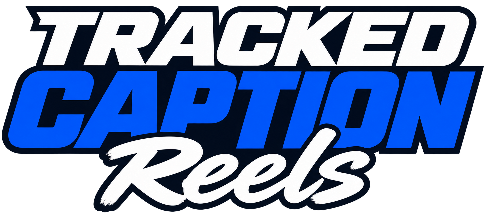
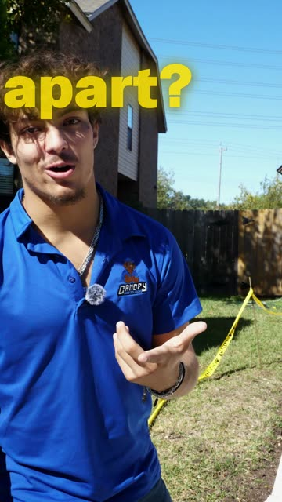
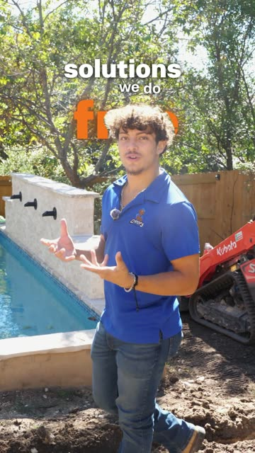
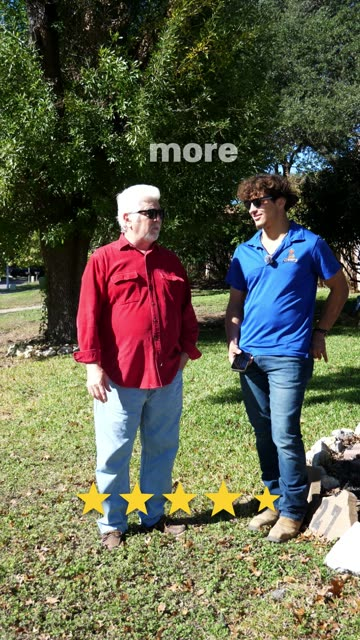
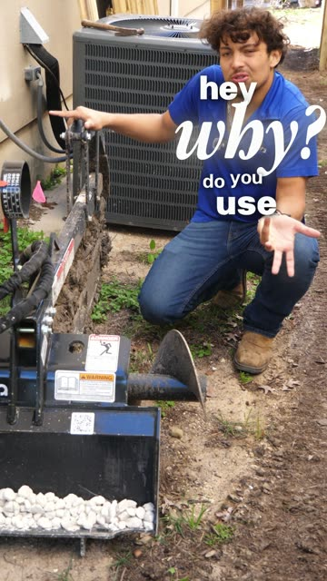
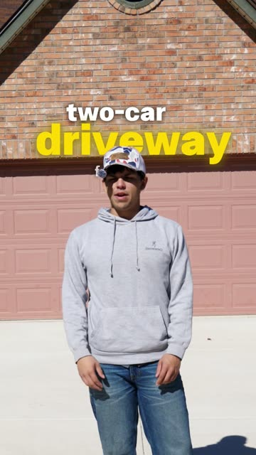
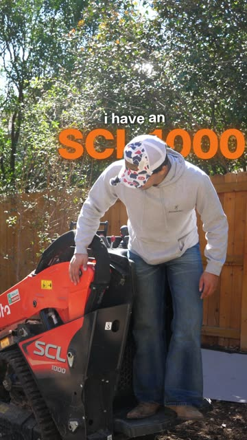
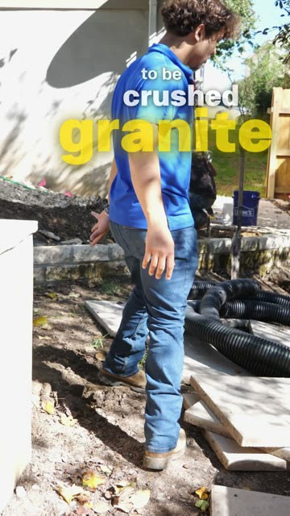
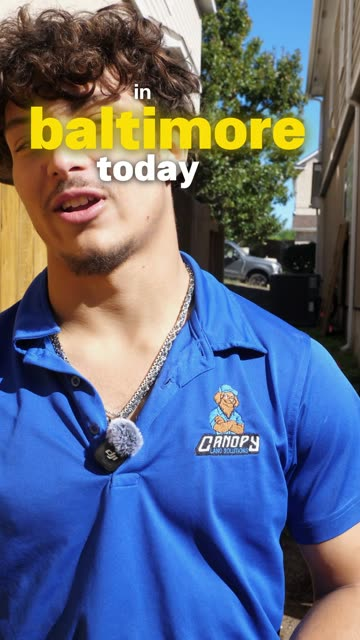
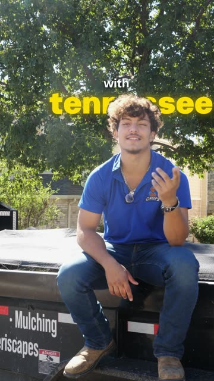

<p align="center"></p>

# Tracked Caption Reels

**Landing page with playable reels and a one-command install: https://justice219.github.io/tracked-caption-reels/**

A [Claude Code](https://claude.com/claude-code) skill, plus the Python engine behind it, for turning raw
talking-head or job-site footage into vertical reels where **the captions ride on the speaker**:

- every spoken line becomes a stack of 2-4 words in mixed sizes, fonts and colours that builds word by word
- key words go large **behind the person's head** (person matte), the rest sits on the chest
- type and punch-in crops **follow the face** (pose tracking)
- numbers count up, B-roll whips in on the word it illustrates, "um"s and pauses are cut
- lip-sync music videos: every take is placed on the exact second of the song it was filmed against

No boxes, panels or name plates. Just type glued to people.

## The look it copies

Three reels set the style (see [`references/inspiration`](references/inspiration/README.md)):
[cowboy captions](https://www.instagram.com/reel/DgDgEH8KPu5/),
a [realtor edit](https://www.instagram.com/reel/DgDuTGiEypd/) and
a [car detailer ad](https://www.instagram.com/reel/DfnWppVheEZ/).

## Result reels

Nine reels made with this engine from one day of landscaping footage (click a cover to play the file).

| | | |
|:-:|:-:|:-:|
| [](examples/driveway-ad.mp4)<br>Driveway ad (27 s) | [](examples/free-3d-design-offer.mp4)<br>Offer with 3D renders (31 s) | [](examples/customer-testimonial.mp4)<br>Two-person testimonial (70 s) |
| [](examples/trencher-explainer.mp4)<br>Equipment explainer (36 s) | [](examples/driveway-and-sidewalk-tour.mp4)<br>Two-presenter tour (70 s) | [](examples/kubota-scl-1000.mp4)<br>Equipment explainer (48 s) |
| [](examples/pool-backyard-walkthrough.mp4)<br>Walk-and-talk (53 s) | [](examples/crew-skit.mp4)<br>Comedy skit with a sticker beat (42 s) | [](examples/lip-sync-music-video.mp4)<br>Lip-sync music video (68 s) |

## How it works

```
transcribe.py  ->  work/mic_*.json      word timestamps for every lav file and clip (mlx-whisper)
sync.py        ->  work/sync.json       where each camera clip starts inside its lav recording
                   work/song_map.json   (lip-sync shoots) which song second plays at each clip second
plan.py        ->  REELS                your edit decisions, written as spoken phrases
edit.py        ->  finished videos/     picture + sound, and a contact sheet per reel
gaps.py        ->  leftover silences    a check on the pause cutting
```

`edit.py` per frame: decode the clip upright, apply the light grade, track the speaker (YOLO11-pose), crop to
the face on jump cuts, draw the current word stack, composite head stacks under the person matte
(YOLO11-seg), then cards. Sound: lav voice cleaned and levelled, one soft effect as each big word lands,
whooshes on B-roll, a quiet music bed.

A plan reads like the script:

```python
REELS["trencher"] = dict(
    file="Why_We_Use_A_Trencher", palette=WARM, music=("Janji-Heroes_Tonight", None),
    audio=[R(M, "Right here is", "great question", 15),        # voice ranges: first words .. last words
           R(M, "for edgings", "proper depth", 33),
           R(M, "it's only 8", "that point", 82)],
    keys={"trencher": None, "why": "why?", "8000": "$8,000", "priceless": None},   # big, behind the head
    broll=[B(M, "concrete footer", 2.3, "P1244604", 3.0, 36.5)],                   # cutaway on a phrase
    cards=[CTA],
)
```

## Install as a Claude Code skill

```sh
git clone https://github.com/Justice219/tracked-caption-reels ~/.claude/skills/tracked-caption-reels
```

Then ask Claude Code to "edit these clips in the tracked captions style". `SKILL.md` is the workflow;
`references/style-rules.md` holds the look in detail.

## Use the engine directly

Requirements: macOS on Apple Silicon (mlx-whisper, and YOLO on the `mps` device), Python 3.11+, and an ffmpeg
build with libwebp.

```sh
mkdir -p MyShoot/{Source/video,Source/mic,Project/work/models} && cd MyShoot/Project
cp ~/.claude/skills/tracked-caption-reels/scripts/*.py .
python3 -m venv .venv && .venv/bin/pip install mlx-whisper ultralytics opencv-python pillow numpy

.venv/bin/python transcribe.py mic ../Source/mic/*.wav      # lav recordings named like TX01_MIC017_....wav
.venv/bin/python transcribe.py cam ../Source/video/*.MP4
.venv/bin/python sync.py                                    # then fill work/project.json (see references/)
cp plan_example.py plan.py                                  # rewrite for your footage
.venv/bin/python edit.py myreel --draft                     # quick look, no matte
.venv/bin/python edit.py myreel                             # final; check work/myreel_sheet.jpg
.venv/bin/python gaps.py myreel
```

`work/project.json` carries everything specific to a shoot: which clip belongs to which lav recording, how each
clip must be turned upright, and where your fonts' companions live (sound effects and music folders, the song
for a lip-sync video). `references/project_example.json` is a filled-in example.

Bring your own fonts (the engine looks in `~/Library/Fonts` for Halenoir Black, Halenoir Bold and Apple
Garamond Bold Italic; change `SANS`, `SERIF`, `SMALL` in `edit.py` for others), sound effects and music. None
are included here.

## Repository layout

| Path | What it is |
|---|---|
| `SKILL.md` | The skill: when to use it, the workflow, the owner's rules, common mistakes |
| `references/style-rules.md` | The look in detail: type, picture, sound |
| `references/project_example.json` | Example per-shoot configuration |
| `scripts/edit.py` | The renderer (tracking, word stacks, crops, B-roll, sound) |
| `scripts/plan_example.py` | Three real plans: an explainer, a short ad with a still cutaway, a lip-sync video |
| `scripts/sync.py`, `transcribe.py`, `words.py`, `retx.py`, `gaps.py` | Sync, transcripts, word times, pause check |
| `references/inspiration/` | Links to the three reels the style copies |
| `index.html` | The GitHub Pages landing page (served from the repository root) |
| `examples/` | The nine result reels (720x1280) and their cover frames |

## Notes

- The result reels show real people and a real business (Canopy Land Solutions, San Antonio) and are
  included as examples of the style only. The lip-sync example contains a commercially released song.
- The reel style follows three public reference reels the owner chose; the code here is original.
- No licence has been chosen yet, so by default all rights are reserved by the author.
